# ScoreKept

**The scorebook for your rec softball team, on your iPhone.** Score every pitch from the dugout, read the game back in a handwritten scorebook, and keep the whole season's stats, with a real ballpark organ playing along.

- **No sign-up.** Open it in Safari, add it to your Home Screen, and start scoring. There's no account to make and nothing to log in to.
- **Works with no signal.** Once it's on your Home Screen, the whole app runs on your iPhone, so a dead zone at the field doesn't matter.
- **Your season stays on your iPhone.** Games, players, and stats are saved on your device, never on someone else's server. Back them up to a file whenever you like.
- **Free.** No ads, no subscription, no tracking.
- **Built for a rec league.** Fort Collins rules are built in (home run limits, run limits, the time limit, courtesy runners, mixed lineups), along with your own. Each team keeps its own rules, so a Summer and a Fall team each start right.
- **A handwritten scorebook.** The Book writes every play the way a scorekeeper does, in real handwriting, with red-pen outs, highlighted runs, and runners traced around the bases.
- **A real ballpark organ.** Walk-up songs, Take Me Out at the stretch, a charge for the rally, and a few notes for a strikeout, all played on the iPhone itself.
- **The back of a baseball card.** Season and career stats, a card for every player, spray charts, and a scouting clipboard for every opponent.

Every line in the app is written ahead of time; recaps and play-by-play come only from what was scored. Nothing in ScoreKept is made up by AI.

**Open it:** https://bullington-steve.github.io/dugout-scorekeeping-app/ (then **Share**, **Add to Home Screen**)

*ScoreKept is a working name, kept while its trademark search is done. This is a rebuild of a first version; see [the rebuild plan](docs/BUILD_PLAN.md).*

## Where the rebuild stands

| Phase | What it brings | Status |
| --- | --- | --- |
| 0. Foundation | Installs to the Home Screen, follows your iPhone’s light appearance, Dark Mode, and text size, automatic tests in Safari’s engine and Chrome’s | Done |
| 1. Scoring engine and stats | Every play, rule, and stat, checked against a simulated scorekeeper | Done |
| 2. Storage, backup, import | Saving that can’t lose your season, backups, and importing first-version backups | Done |
| 3. App shell and the Game tab | The tab bar and scoring a whole game on your iPhone | Done |
| 4. Teams, players, New Game | Editing your team, the full lineup builder, seasons and the schedule | Done |
| 5. Book, Stats, Scout | The scorebook in your handwriting, every stat, spray charts, scouting | Done |
| 6. Defense and team tools | The Defense card, depth chart, dues, more than one team | Done |
| 8. First launch and safety nets | Works with no signal, PLAY BALL! intro, welcome and setup, tours, backup reminders, the screen stays on during games | Done |
| 7. Sound | The ballpark organ, game sounds, walk-ups, the Organ pad, PA announcer and umpire | Done |
| 9. Sharing and Discord | Recap and Scorecard pictures, sharing, Discord polls and posts, board flashes | Done |
| 10. Parity check | Every screen at every size and setting, checked in both appearances and both browsers | Done (your six checks open) |
| 11–12. Game Night Ready, The Look | The speed check, edge to edge, easier on the eyes, color-blind safe | Built; Steve’s iPhone checks next |
| 13–14. Team Identity, Book and Ballpark | Logos, the app’s name, Book notes, more tunes | Waiting on Steve’s picks |
| 15. Game Replay | Any game played back on the field | Built (sharing as a video still to come) |

Every tab now shares one set of paper: surfaces run edge to edge, lists are ruled rows that shade when you tap them, and every screen’s last row clears the tab bar. All five tabs are back: score a game on the Game tab, read it in your handwriting on the Book, and see the season on Stats and every opponent on Scout. The Defense card and team tools are back too, and the app now opens with no signal, welcomes new scorekeepers with a minute of setup, and offers short tours. The ballpark organ, walk-ups, sharing, Discord, and the light shows are back too. Every feature of the first version is in; what comes next is in [the rebuild plan](docs/BUILD_PLAN.md), Phases 11–15.

<p>
  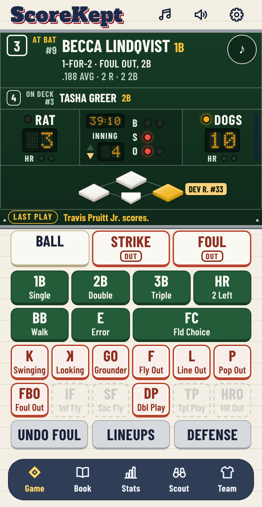
  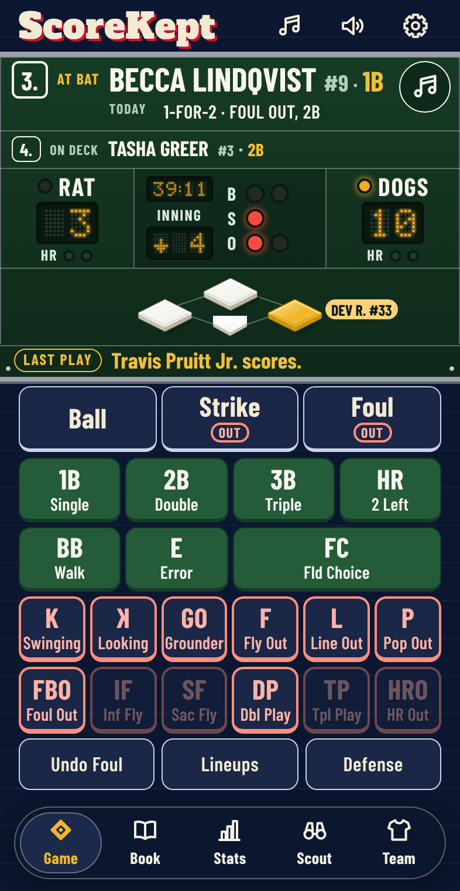
  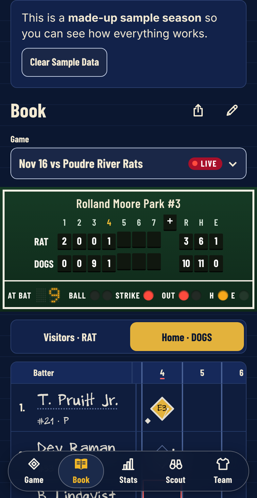
  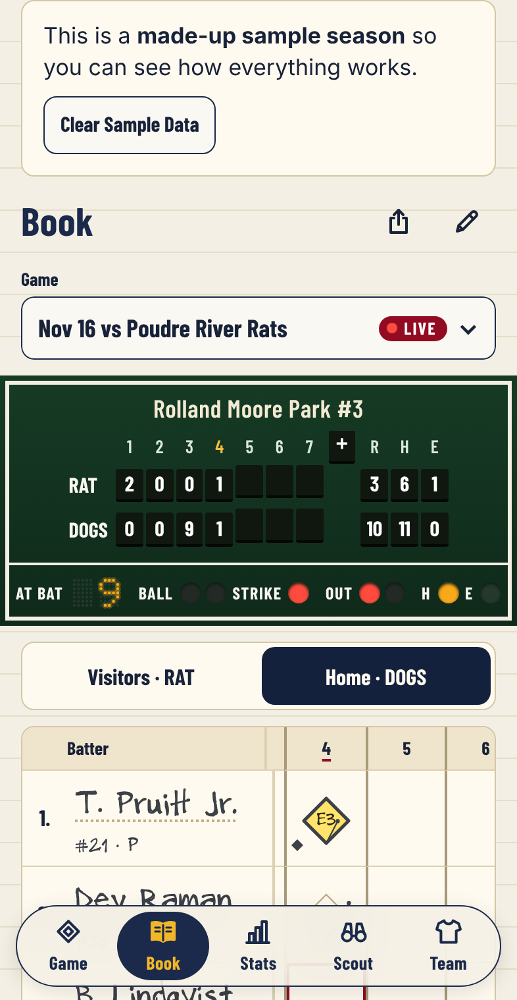
  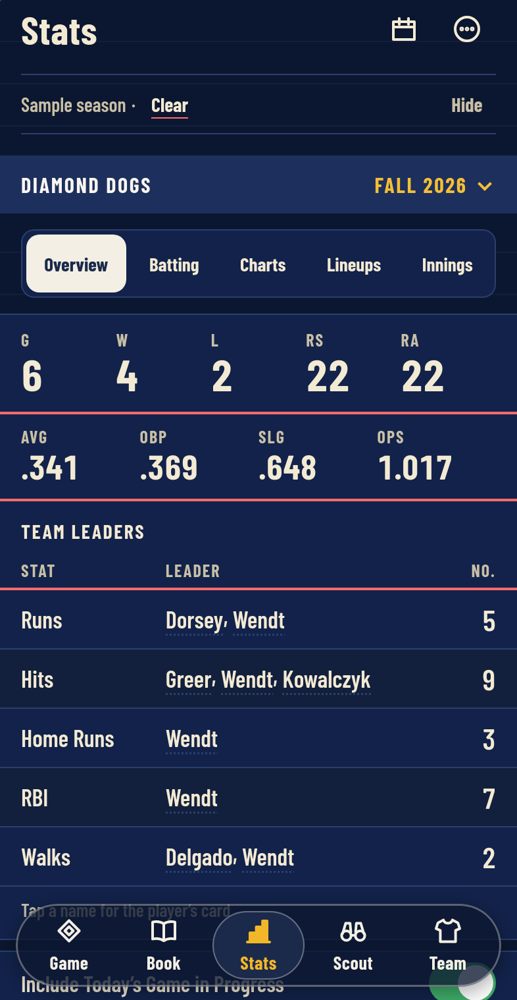
  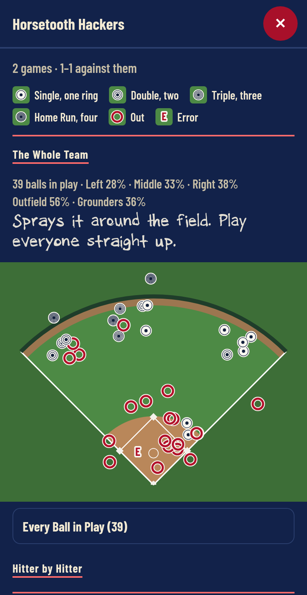
  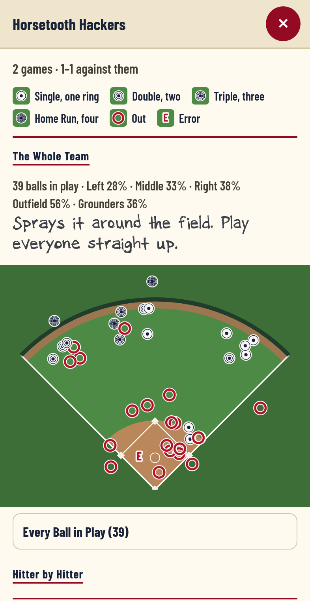
  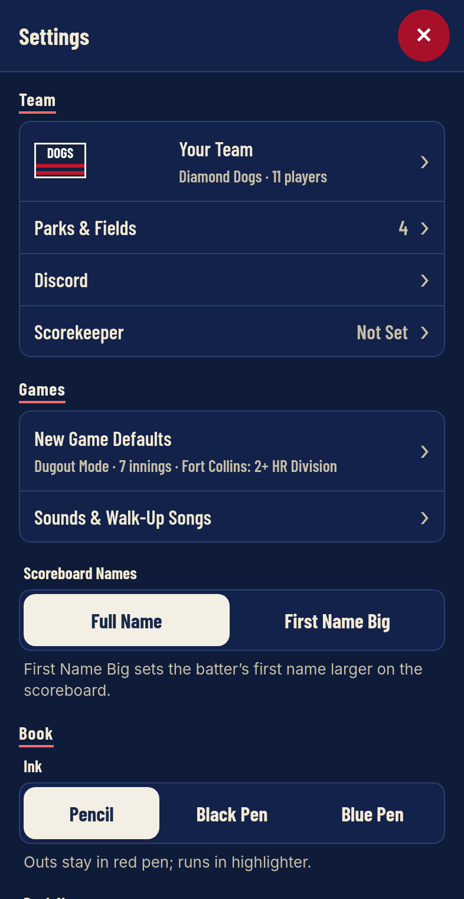
  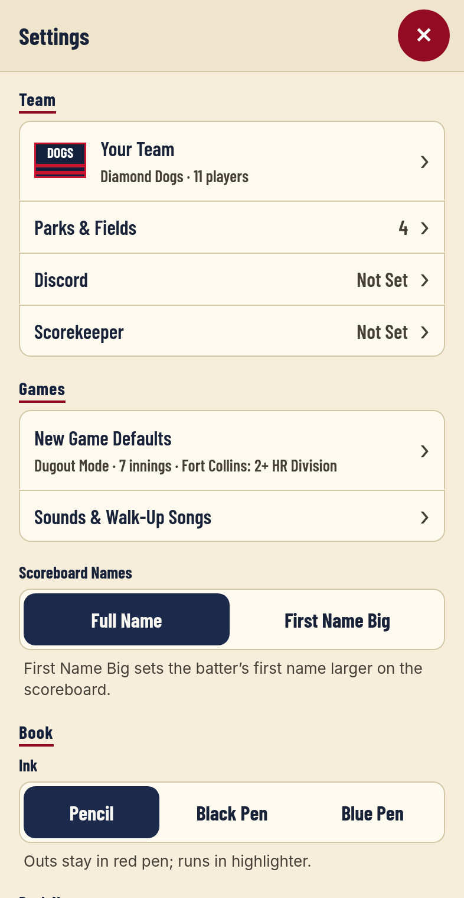
  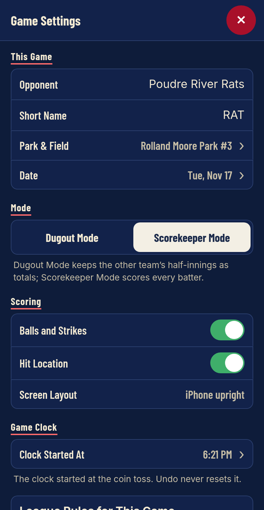
  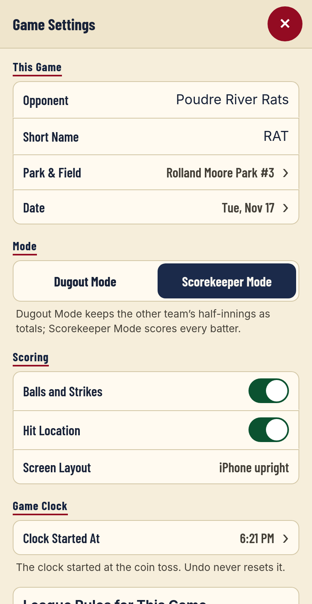
  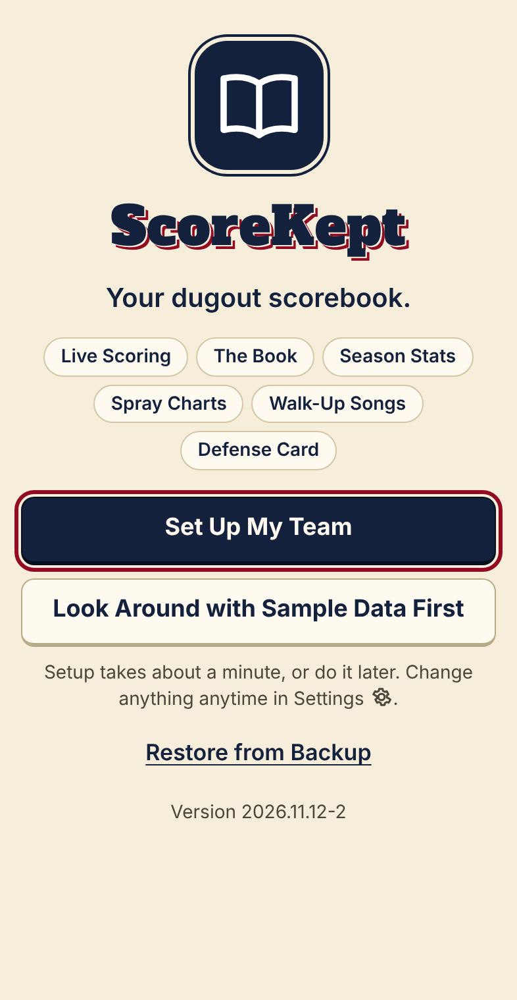
  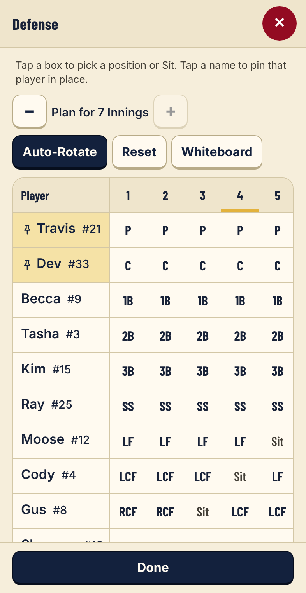
</p>

## Looking around first

On a new iPhone or iPad, tap **PLAY BALL!**, then **Look Around with Sample Data First** on the welcome screen (or **Set Up My Team** for your own; setup takes about a minute). The made-up Diamond Dogs come with six games played, tonight’s game in the fourth inning, and two more on the schedule. When you’re ready for your own team, tap **Clear** on the slim “Sample season” line under each tab’s title (every tab but Game); **Hide** tucks it away until you close the app.

## Setting up your team

1. On the **Team** tab, tap **Edit Team** for your name, short name, and colors: one grid of all 18 with **Primary** and **Secondary** above it, and the score bug pinned on top (or pick from **Big League Colors**). The teams you play are saved with colors too (**Game Settings**, **Opponent Colors**), so their pennant shows on the recap and in Scout. Your team flies a felt pennant in both colors (the first is the felt, the second the stripe by the staff and the outline on the letters), and a small striped patch where room is tight. The Team tab is a roster card; tap **+** to add a team and the team's name to switch. It saves as you go; tap **✕** when you’re done.
2. Tap **+ Add Player** for each player: name, number, up to three positions, which side they bat from, and a photo if you like. Reserves go under **+ Add Reserve**, with a phone number for the **Text** button.
3. Add the season’s games with **+ Add a Game**. The next one shows as **Up Next** on the Game tab.

## Scoring a game

1. On the Game tab, tap **New Game** (or **Start This Game** under Up Next). Check **Who’s Here**, build the batting order by tapping players (drag **☰** to reorder, or try **Auto-Fill**, **Same as Last Game**, or **Suggest Order** in the style beside it: **Spread**, **Traditional**, or **Best First**), then fill in **Game Details**.
2. At the coin toss, tap **We’re Visitors (Bat First)** or **We’re Home (Bat Second)**. The clock starts; when time runs out it reads 0:00 under LAST INN.
3. Tap the solid green buttons when a batter reaches and the red-pen ones when a batter’s out. Every key keeps its place: Infield Fly, Sac Fly, Double Play, Triple Play, and HR Out are dimmed until they can happen (tap one to hear why). The **Last** line on the board confirms what you just scored, and **Undo** names what it will take back. The top of the scoreboard shows the batter, one line of stats (the season before their first trip, then today), and who’s on deck. With **Balls and Strikes** on, tap **Ball**, **Strike**, or **Foul** for each pitch; Strike on the out pitch is a swinging strikeout, and the backwards **K** is a called one. With **Hit Location** on, tap where the ball went, then **Save** (or **Skip**).
4. Tap a lit base for that runner's menu on the scoreboard. Right after a play: **+1 Advance**, **Score** (with or without the RBI), **Out**, and **−1 Move Back**. Between pitches, what the game's rules allow: in slowpitch, **Out** (or **Left Early**) and a courtesy runner; with stealing on, **SB**, **CS**, and **PO**; with wild-pitch advances on, **WP** and **PB**. **CR** puts in a courtesy runner, and **More** has the full list. A fielder's choice or double play with more than one runner on asks you to tap which runner was out.
5. When the game ends, tap **Save to Season**, then **Back Up Now**.

> **Tip:** The Game screen sizes itself to whatever it’s on, from the iPhone SE to the biggest iPad, upright or sideways, with nothing to scroll. Upright, the buttons grow to fill the screen; sideways, the scoreboard sits left and the buttons right.

## Reading the Book, Stats, and Scout

The tab bar stays at the bottom of every screen while you scroll, so any tab is one tap away.

- **Book:** every at-bat in its box, in your handwriting (names, jersey numbers, positions, and times too): the path around the bases in pencil, outs circled in red, runs in yellow highlighter with a small solid diamond, and a short pencil slash across the corner where each half-inning ended. The footer shows the first pitch, the final, and how long the game took. Tap any box or play-by-play line to **Edit Play**; everything after it is re-scored, on saved games too. Switch teams with the short names above the page, and pick another game from the **Game** menu. Choose **Pencil**, **Black Pen**, or **Blue Pen** with the ✎ button or in Settings.
- **Under each name**, in pencil, what a scorekeeper jots down: jersey number, positions with each move and its inning ("SS → P (5)"), and the inning a sub came in. The batting order reads 1., 2., and so on; only jersey numbers carry #.
- **Watch Replay** (above the play-by-play): the game played back on the field, play by play: the ball’s line out to where it landed, runners moving around the bases, and the score and outs ticking along. **Play**, **Back**, **Next**, or jump to any half-inning.
- **Stats:** the back of a baseball card. Tap the season in the navy band (or pick **All Seasons**); the calendar opens the **Schedule** (with **Add to Calendar**) and **•••** holds **New Season**, **Export Batting (CSV)**, and **Export Games (CSV)** for Numbers, Excel, or Google Sheets. Then **Overview** (G, W, L, RS, RA, the team's AVG, OBP, SLG, and OPS under them, the team leaders in a printed table, every game with **View**), **Batting** (Standard, Advanced, Contact, and Fielding tables; tap a column to sort), **Charts** (spray charts; tap near a ball to see the play, move it, or **View Game**), **Lineups**, and **Innings** (field innings against a fair share). Tap a name for the player card, whose spray chart has its own key (one ring for a single up to four for a home run, a red circle for an out, E for an error); balls hit to the same spot fan out so every one shows.
- **Scout:** every opponent you’ve played. Tap one for its clipboard: where they hit the ball, as a team and hitter by hitter, with the coach’s read in handwriting. Hits are dots with a ring per base, outs red circles, errors an E.

> **Tip:** **Undo** takes back the last tap. The gear during a game opens **Game Settings**: switch modes, turn the count or hit location on or off, switch home and away between innings, or **End Game Now**.

## The Defense card and team tools

- **Defense** (under the scoring buttons during a game): players down the side, innings across. Tap a box for a position or **Sit**; a taken position trades the two players. Tap a name to pin it (pitcher and catcher start pinned). **Auto-Rotate** fills the innings still to come so nobody sits twice until everyone has sat once. **Plan for** sets how many innings it fills, **Reset** clears the ones not played yet, and **Whiteboard** draws the card the dugout way (innings 1 and 5, 2 and 6, 3 and 7 share a column) with **Share Picture**.
- **Team Tools** on the Team tab: **Depth Chart** (who can play each position, thin spots in red) and **Dues** (the league fee split across the roster, **Paid in Full** or an amount, **Doesn’t Pay**, and what’s left to collect).

## Sharing and Discord

- **Share Card** on any player card: the card as a picture for the team chat.
- **Share** on the Book, or **Share Recap** after **Save to Season**: the **Recap** picture (final, line score, Stars of the Game) or the **Scorecard** (your Book page), with **Share Picture**, **Share Text**, **Copy Text**, and **Post to Discord**.
- **Settings**, **Discord**: paste your channels' webhook links and tap **Save & Test**. They stay on your iPhone and are never in a backup. **Who's In? Poll** on the Up Next card posts a real Discord poll that closes at game time.
- In Scorekeeper Mode the Game scoreboard's frame flashes for home runs and walk-offs.
- The Book opens a live game with the inning being played fully in view, even after batting around, and the batter at the plate marked with a gold ribbon down their row and a gold box on their at-bat. The names column is as wide as the longest name (at most a quarter of the width), and the innings share the rest, so every box is wide enough for big, clear marks. The board above the page fills its width with big number plates and scrolls sideways in extra innings, team names pinned. A zoom button (a magnifier with a plus) picks Page, Normal, or Close-up (which follows the batter at the plate), and the inning numbers stay pinned at the top as you scroll down. A batted-around inning keeps its number in view beside the names while you swipe through it. Every finished game is checked the way a paper scorer proves a book: every batter ends each half-inning scored, put out, or left on base, and Help's How ScoreKept Scores compares our marks with the paper method.
- The Book's scoreboard and its scorebook page both run the full width of the iPhone, like the Game board.
- The Book writes first names, the way a scorer does (two players with one first name get an initial: “Cody W.”); **Settings**, **Book**, **Book Names** switches to last names.
- First-version backups bring their ball spots over in fair territory, and a moved ball redraws on the player card at once.
- Text can't be selected or copied, like a native app (fields you type in still can).
- The Organ is ScoreKept's own player: board green with the painted frame, an amber screen with the live inning and score, a navy wheel with a gold center, the whole screen in green with a painted frame rounded at all four corners and Stretch under the wheel, all eight albums on the first screen, with Now Playing, Up Next, and time left.
- Every scoreboard wears a painted-sign frame: a cream stripe set inside the green edge and cream lines between its sections.

## The organ

Every sound is played live by a Hammond organ in the app, so nothing downloads and it works with no signal. Sounds play even when the iPhone is set to Silent (the app's speaker button is the one mute), and the first sound pauses music playing in another app. Tap the music notes at the top of the Game tab for the **Organ**, a pocket player of our own (spin a finger around the Organ's wheel to scroll, press the middle to choose, **MENU** to go back; **Settings** at the bottom of its menu opens every sound setting), and the speaker to turn game sounds on and off (it lights up and plays a short tune when sound comes on). Each player's walk-up is on their card. **Settings**, **Sounds & Walk-Up Songs** has the rest, including **Big Speaker Mode** (the spinning ballpark swirl and a big echo, for a Bluetooth speaker; off is the standard plain organ) and **Echo** (Off, Small Gym, Ballpark, or Big Stadium). To hear everything at once, open `sounds.html` on the site in Safari.

Where the notes came from:

| Tune | Source |
| --- | --- |
| Take Me Out to the Ball Game | Sheet music: Von Tilzer and Norworth, York Music Co., 1908 (IMSLP), the chorus once, straight in; plays at the stretch |
| The National Game | Sheet music: John Philip Sousa, Sam Fox Publishing Co., 1925 (IMSLP, band parts; checked against the U.S. Marine Band’s edition): the introduction and first strain for pregame, and the last 16 bars for a win |
| Tiger Rag | Sheet music: Original Dixieland Jass Band (Nick LaRocca), Leo Feist, 1917 (IMSLP): the first eight bars of the last strain, melody only; the later words are never used |
| Three Strikes Two-Step | Sheet music: A. W. Bauer, Bauer Bros. Music Co., Oshkosh, 1902 (Levy Sheet Music Collection): the introduction and the start of the first strain |
| The Base Ball Polka | Sheet music: J. R. Blodgett, 1858 (Levy Sheet Music Collection), introduction and first strain |
| Tally One for Me | Sheet music: John T. Rutledge, 1877 (Levy Sheet Music Collection), the waltz chorus |
| Home Run Galop | Sheet music: Edward M. Read, 1903 (Library of Congress), the first strain |
| Over the Fence Is Out! | Sheet music: J. P. Skelly, Petrie Music Co., 1895 (Library of Congress): the last eight bars of the chorus, where the title is sung; plays on every HR Out |
| Funiculì, Funiculà | Sheet music: Luigi Denza and Peppino Turco, 1880 (Ricordi, IMSLP), the refrain |
| The Star-Spangled Banner | Sheet music: the melody from a B-flat lead sheet (John Stafford Smith, words by Francis Scott Key, 1814); our own chords |
| 1812 Overture Finale | Sheet music: Tchaikovsky, 1880, the piano version’s Allegro vivace finale theme |
| Mars, the Bringer of War (walk-up) | Score: Holst, The Planets (OpenScore), the opening 5/4 rhythm and the bassoons’ theme |
| Rex Tremendae (walk-up) | Sheet music: Mozart, Requiem, 1791, the opening runs and the three big opening chords |
| Ode to Joy, Happy Birthday to You, Three Blind Mice, Shave and a Haircut, Reveille, Cavalry Charge, Charge! | Well-known tunes, from memory |
| Hallelujah Chorus, William Tell Galop, Toccata in D Minor, Mexican Hat Dance, The Irish Washerwoman | From memory, to check against sheet music |
| Here We Go, Clap-Along Rally, Victory Fanfare, Take the Lead, Soul Organ Groove, Bullfighter, So Long, the game sounds, and the eight walk-ups | Originals written for ScoreKept |

Still to come, from sheet music: The Infernal Dance (Stravinsky; Steve’s score is in). The Organ’s Now Playing shows each tune’s composer and year under its name, the time left, and what’s up next.

## Bring your season over from the old app

1. In the old ScoreKept, save a backup (Settings, Backup & Restore, **Save Backup**) to Files or iCloud Drive.
2. In this app, open **Settings**, then **Backup & Restore**, then **Restore from Backup**, and pick that file.
3. Check the summary, then tap **Restore This Backup**.

## Add it to your Home Screen

1. Open the link above in **Safari** on your iPhone.
2. On iOS 27, tap the Page Menu button (**≡**) at the left of the address bar, then **Share**. On iOS 26, tap **•••** beside the address bar, then **Share**. (With Safari’s Tabs set to Bottom or Top, or on an older iPhone, tap **Share** in the toolbar. On iPad, **Share** is at the top right.)
3. Scroll down and tap **Add to Home Screen**. If it isn’t there, tap **Edit Actions** at the bottom of the list and add it.
4. Leave **Open as Web App** on, then tap **Add**.

The app shows these steps itself on the first visit in Safari, with a drawing for each, matched to your iPhone’s iOS version.

> **Tip:** After an update, close the app fully (swipe up from the bottom and swipe ScoreKept away), then open it again. The version number at the bottom of the page shows which version you have.

> **Tip:** The Home Screen app keeps its own data. Deleting the Home Screen icon deletes that data, so always back up first: Settings, **Backup & Restore**, **Back Up Now**.

## For whoever works on the code

Read [CLAUDE.md](CLAUDE.md) first, then the files in [docs](docs). The look follows Steve's Master Specification ([docs/MASTER_SPEC.md](docs/MASTER_SPEC.md)): "nothing the real object doesn't have," one locked color palette, and four fonts (the ScoreKept wordmark, the athletic condensed face for every control, the scoreboard bulbs, and Steve's handwriting in the Book only).

- `src/engine`: the scoring engine (a game is a list of events, replayed into state)
- `src/stats`: stats as pure functions of saved events
- `src/store`: saving (with quarantine and migrations), backups, song files, and importing first-version backups
- `src/ui`: screens; `src/styles/tokens.css` holds every color, starting from the locked Master Spec palette (`--sk-*`, [docs/MASTER_SPEC.md](docs/MASTER_SPEC.md))
- `src/audio`: the ballpark organ
- `tests/unit` (Vitest), `tests/e2e` (Playwright, Chromium and WebKit), `tests/helpers` (shared contrast, 44-point tap, zoom, and fit checks)
- `tests/sim/hand-scorer.ts`: the hand scorer, an independent scorekeeper that plays random seasons; the engine and stats must match its sheet exactly
- `tests/e2e/dugout-sim.spec.ts`: the dugout simulator, which taps the hand scorer's games into the real app (both rule sets, a faked clock for the time limit, hit locations, Undo, and Edit Play) and checks every score and batting stat
- `tests/fixtures`: a real first-version backup with the names replaced, and a frozen copy of today's saved data that every future version must still read
- [docs/BETA_PLAN.md](docs/BETA_PLAN.md): what has to be true before testers, and who does each part
- `tools/`: the icon renderer (`npm run icons` turns `tools/icon.svg` and `tools/icon-maskable.svg` into the Home Screen icons and the splash screens). The icon is a cream diamond on scoreboard green with second base lit in gold, inside the board's cream painted frame.

```bash
npm ci
```

```bash
npm test
```

`npm test` runs the type check, unit tests, a build, and the browser tests. Every push to `main` runs the same tests on GitHub in Chromium and WebKit, and the app is published to GitHub Pages only when all of them pass.

## Contact

Questions, ideas, or something broken: **ScoreKeptApp@gmail.com**. In the app, **Settings**, **Send Feedback**, **Email It** writes the email for you with the app's version.

## Privacy

Everything you score stays on your iPhone: no account, no ads, no tracking. The app goes online for two things, only when you use them: the weather at the field (your location rounded to about a kilometer, sent to Open-Meteo, only if you allow it) and Discord posts to channels you set up. **Directions** in Parks & Fields opens Apple Maps with the park's name, only when you tap it. Send Feedback opens Mail with your note to ScoreKeptApp@gmail.com (or copies it), with a short error log if something broke; nothing is sent until you tap Send. The same words are in the app: **Settings**, **Privacy**.

## Credits

- Alfa Slab One by The Alfa Slab One Project Authors (SIL Open Font License 1.1), self-hosted in `src/assets/fonts`.
- Barlow Condensed by The Barlow Project Authors (SIL Open Font License 1.1), self-hosted in `src/assets/fonts`.
- Weather data by Open-Meteo.com (CC BY 4.0).
- The same credits are in the app: **Settings**, **About**.
- The Book’s handwriting is Steve’s own, made with Calligraphr (`steve-hand.woff2`), with Kalam by Indian Type Foundry (SIL Open Font License 1.1) for the few characters it doesn’t have.
