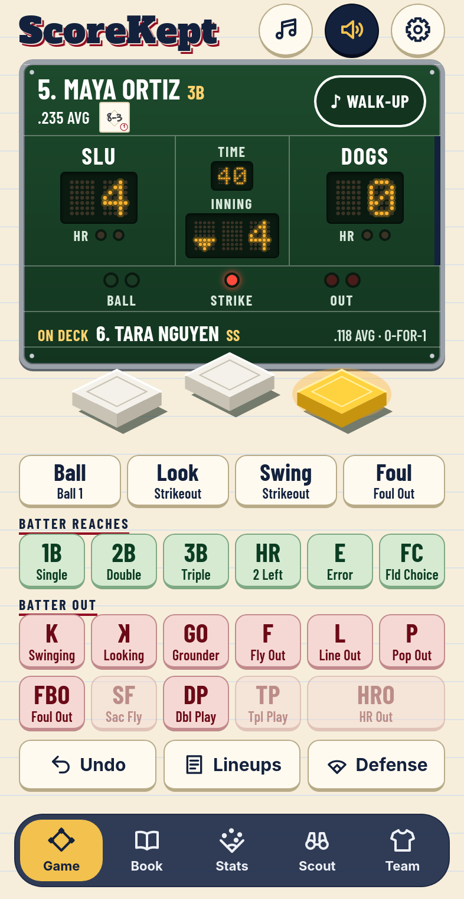
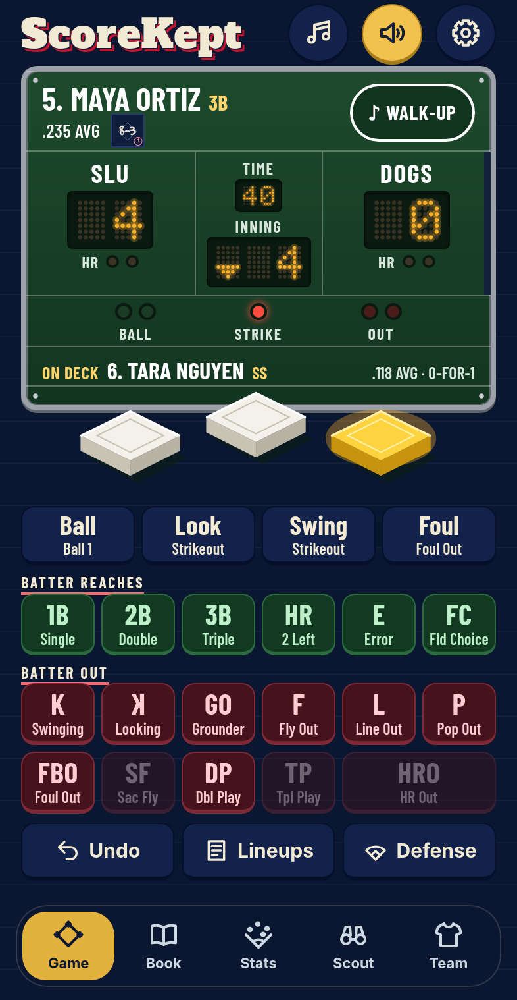
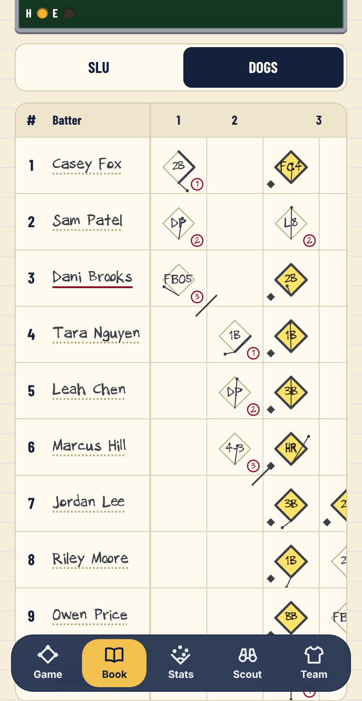
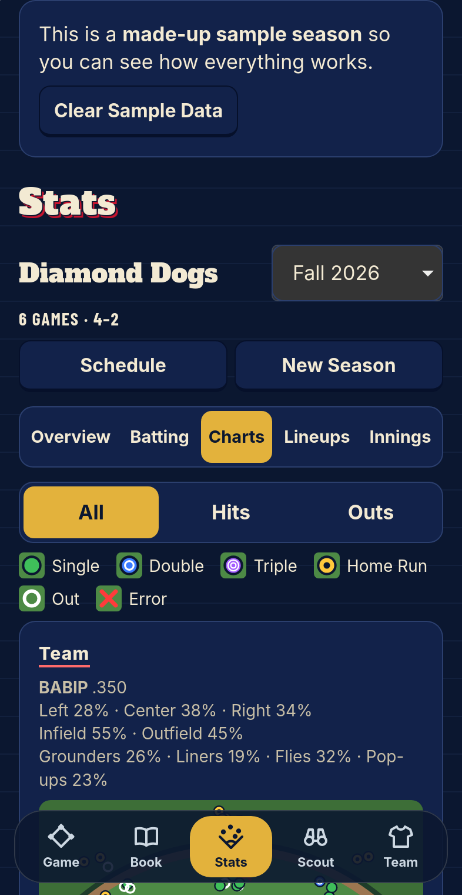
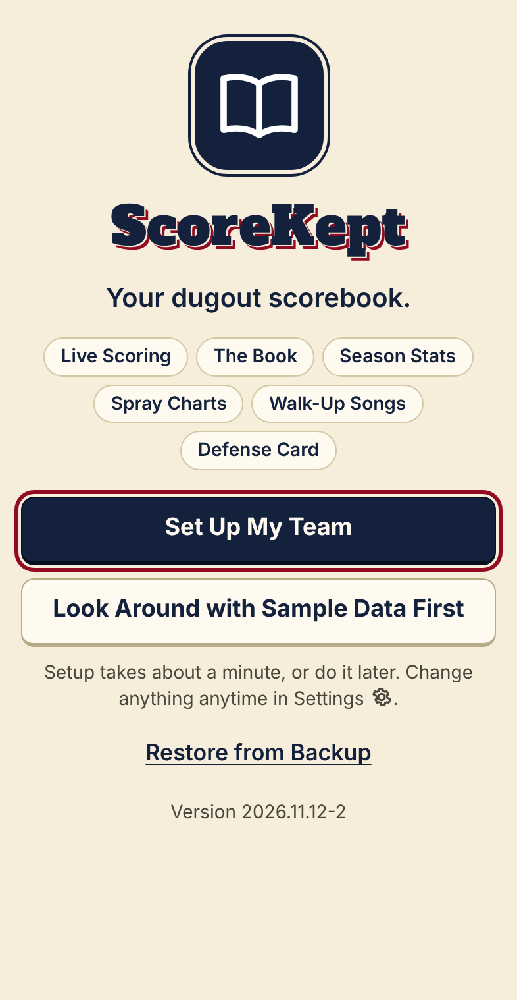
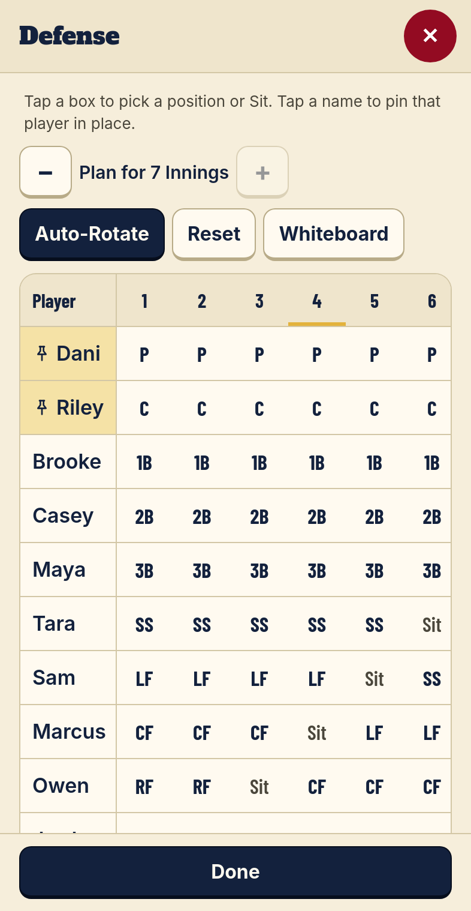

# ScoreKept

A softball scorebook for iPhone and iPad. ScoreKept installs to your Home Screen from Safari, works with no signal, needs no account, and keeps your season on your own device.

*ScoreKept is a working name. This is a rebuild of a first version; see [the rebuild plan](docs/BUILD_PLAN.md).*

**Open it:** https://bullington-steve.github.io/dugout-scorekeeping-app/

## Where the rebuild stands

| Phase | What it brings | Status |
| --- | --- | --- |
| 0. Foundation | Installs to the Home Screen, follows your iPhone’s light appearance, Dark Mode, and text size, automatic tests in Safari’s engine and Chrome’s | Done |
| 1. Scoring engine and stats | Every play, rule, and stat, checked against a simulated scorekeeper | Done |
| 2. Storage, backup, import | Saving that can’t lose your season, backups, and importing first-version backups | Done |
| 3. App shell and the Game tab | The tab bar and scoring a whole game on your iPhone | Done |
| 4. Teams, players, New Game | Editing your team, the full lineup builder, seasons and the schedule | Done |
| 5. Book, Stats, Scout | The scorebook in your handwriting, every stat, spray charts, scouting | Done |
| 6. Defense and team tools | The Defense card, depth chart, dues, more than one team | Done |
| 8. First launch and safety nets | Works with no signal, PLAY BALL! intro, welcome and setup, tours, backup reminders, the screen stays on during games | Done |
| 7. Sound | The ballpark organ, game sounds, walk-ups, the Organ pad, PA announcer and umpire | Done |
| 9. Sharing and Discord | Recap and Scorecard pictures, sharing, Discord polls and posts, light shows, night games | Done |
| 10. Parity check | Every screen at every size and setting, checked in both appearances and both browsers | Done (your six checks open) |
| 11–15. What’s next | Game Night Ready, The Look, Team Identity, Book and Ballpark, Game Replay | Planned |

All five tabs are back: score a game on the Game tab, read it in your handwriting on the Book, and see the season on Stats and every opponent on Scout. The Defense card and team tools are back too, and the app now opens with no signal, welcomes new scorekeepers with a minute of setup, and offers short tours. The ballpark organ, walk-ups, sharing, Discord, and the light shows are back too. Every feature of the first version is in; what comes next is in [the rebuild plan](docs/BUILD_PLAN.md), Phases 11–15.

<p>
  
  
  
  
  
  
</p>

## Looking around first

On a new iPhone or iPad, tap **PLAY BALL!**, then **Look Around with Sample Data First** on the welcome screen (or **Set Up My Team** for your own; setup takes about a minute). The made-up Diamond Dogs come with six games played, tonight’s game in the fourth inning, and two more on the schedule. When you’re ready for your own team, tap **Clear Sample Data** on the banner (it shows on every tab but Game on iPhone).

## Setting up your team

1. On the **Team** tab, tap **Edit Team** for your name, short name, and colors (or pick from **Big League Colors**).
2. Tap **+ Add Player** for each player: name, number, up to three positions, which side they bat from, and a photo if you like. Reserves go under **+ Add Reserve**, with a phone number for the **Text** button.
3. Add the season’s games with **+ Add a Game**. The next one shows as **Up Next** on the Game tab.

## Scoring a game

1. On the Game tab, tap **New Game** (or **Start This Game** under Up Next). Check **Who’s Here**, build the batting order by tapping players (drag **☰** to reorder, or try **Auto-Fill**, **Same as Last Game**, or **Suggest Order**), then fill in **Game Details**.
2. At the coin toss, tap **We’re Visitors (Bat First)** or **We’re Home (Bat Second)**. The clock starts.
3. Tap the green buttons when a batter reaches and the red ones when a batter’s out. The batter’s card shows today’s at-bats as little Book boxes. With **Hit Location** on, tap where the ball went, then **Save** (or **Skip**).
4. Tap a lit base to move a runner: **Advance**, **Scored on the Play**, **Out**, or **Courtesy Runner**.
5. When the game ends, tap **Save to Season**, then **Back Up Now**.

## Reading the Book, Stats, and Scout

- **Book:** every at-bat in its box, in your handwriting: the path around the bases in pencil, outs circled in red, runs in yellow highlighter with a small solid diamond, and a heavy slash across the corner where each half-inning ended. Tap any box or play-by-play line to **Edit Play**; everything after it is re-scored, on saved games too. Switch teams with the short names above the page, and pick another game from the **Game** menu. Choose **Pencil**, **Black Pen**, or **Blue Pen** with the ✎ button or in Settings.
- **Stats:** pick a season (or **All Seasons**), then **Overview** (record, leaders, every game with **View**), **Batting** (Standard, Advanced, Contact, and Fielding tables; tap a column to sort), **Charts** (spray charts; tap near a ball to see the play, move it, or **View Game**), **Lineups**, and **Innings** (field innings against a fair share). Tap a name for the player card.
- **Scout:** every opponent you’ve played. Tap one for where they hit the ball, as a team and hitter by hitter.

> **Tip:** **Undo** takes back the last tap. The gear during a game opens **Game Settings**: switch modes, turn the count or hit location on or off, switch home and away between innings, or **End Game Now**.

## The Defense card and team tools

- **Defense** (under the scoring buttons during a game): players down the side, innings across. Tap a box for a position or **Sit**; a taken position trades the two players. Tap a name to pin it (pitcher and catcher start pinned). **Auto-Rotate** fills the innings still to come so nobody sits twice until everyone has sat once. **Plan for** sets how many innings it fills, **Reset** clears the ones not played yet, and **Whiteboard** draws the card the dugout way (innings 1 and 5, 2 and 6, 3 and 7 share a column) with **Share Picture**.
- **Team Tools** on the Team tab: **Depth Chart** (who can play each position, thin spots in red) and **Dues** (the league fee split across the roster, **Paid in Full** or an amount, **Doesn’t Pay**, and what’s left to collect).

## Sharing and Discord

- **Share** on the Book, or **Share Recap** after **Save to Season**: the **Recap** picture (final, line score, Stars of the Game) or the **Scorecard** (your Book page), with **Share Picture**, **Share Text**, **Copy Text**, and **Post to Discord**.
- **Settings**, **Discord**: paste your channels' webhook links and tap **Save & Test**. They stay on your iPhone and are never in a backup. **Who's In? Poll** on the Up Next card posts a real Discord poll that closes at game time.
- In Scorekeeper Mode the Book's stadium lights put on a show for home runs and walk-offs, and stay on for night games (sunset worked out for Fort Collins).

## The organ

Every sound is played live by a ballpark organ in the app, so nothing downloads and it works with no signal. Tap the music notes at the top of the Game tab for the **Organ**, a click-wheel player (slide to scroll, press the middle to choose, **MENU** to go back), and the speaker to turn game sounds on and off (it lights up and plays a short tune when sound comes on). Each player's walk-up is on their card. **Settings**, **Sounds & Walk-Up Songs** has the rest. To hear everything at once, open `sounds.html` on the site in Safari.

Where the notes came from:

| Tune | Source |
| --- | --- |
| Take Me Out to the Ball Game | Sheet music: Von Tilzer and Norworth, 1908 (IMSLP), the full chorus |
| The Base Ball Polka | Sheet music: Blodgett (Levy Sheet Music Collection), introduction and first strain |
| Tally One for Me | Sheet music: John T. Rutledge, 1877 (Levy Sheet Music Collection), the waltz chorus |
| Ode to Joy, Happy Birthday to You, Three Blind Mice, Shave and a Haircut, Reveille, Cavalry Charge, Charge! | Well-known tunes, from memory |
| Hallelujah Chorus, William Tell Galop, Toccata in D Minor, Mexican Hat Dance, The Irish Washerwoman | From memory, to check against sheet music |
| Here We Go, Clap-Along Rally, Victory Fanfare, Take the Lead, Soul Organ Groove, Bullfighter, So Long, the game sounds, and the eight walk-ups | Originals written for ScoreKept |

Still to come, from sheet music: The Star-Spangled Banner, Funiculì, Funiculà, and the 1812 Overture finale.

## Bring your season over from the old app

1. In the old ScoreKept, save a backup (Settings, Backup & Restore, **Save Backup**) to Files or iCloud Drive.
2. In this app, open **Settings**, then **Backup & Restore**, then **Restore from Backup**, and pick that file.
3. Check the summary, then tap **Restore This Backup**.

## Add it to your Home Screen

1. Open the link above in **Safari** on your iPhone.
2. Tap **≡** in the address bar, then **Share**. (Older iPhones: tap **Share** at the bottom.)
3. Scroll down and tap **Add to Home Screen**. Tap **View More** if you don’t see it.
4. Leave **Open as Web App** on, then tap **Add**.

> **Tip:** After an update, close the app fully (swipe up from the bottom and swipe ScoreKept away), then open it again. The version number at the bottom of the page shows which version you have.

> **Tip:** The Home Screen app keeps its own data. Deleting the Home Screen icon deletes that data, so always back up first: Settings, **Backup & Restore**, **Back Up Now**.

## For whoever works on the code

Read [CLAUDE.md](CLAUDE.md) first, then the files in [docs](docs).

- `src/engine`: the scoring engine (a game is a list of events, replayed into state)
- `src/stats`: stats as pure functions of saved events
- `src/store`: saving (with quarantine and migrations), backups, song files, and importing first-version backups
- `src/ui`: screens; `src/styles/tokens.css` holds every color
- `src/audio`: the ballpark organ
- `tests/unit` (Vitest), `tests/e2e` (Playwright, Chromium and WebKit), `tests/helpers` (shared contrast, 44-point tap, zoom, and fit checks)
- `tests/sim/hand-scorer.ts`: the hand scorer, an independent scorekeeper that plays random seasons; the engine and stats must match its sheet exactly
- `tools/`: the icon renderer (`npm run icons` turns `tools/icon.svg` into the Home Screen icons)

```bash
npm ci
```

```bash
npm test
```

`npm test` runs the type check, unit tests, a build, and the browser tests. Every push to `main` runs the same tests on GitHub in Chromium and WebKit, and the app is published to GitHub Pages only when all of them pass.

## Credits

- Alfa Slab One by The Alfa Slab One Project Authors (SIL Open Font License 1.1), self-hosted in `src/assets/fonts`.
- The Book’s handwriting is Steve’s own, made with Calligraphr (`steve-hand.woff2`), with Kalam by Indian Type Foundry (SIL Open Font License 1.1) for the few characters it doesn’t have.
